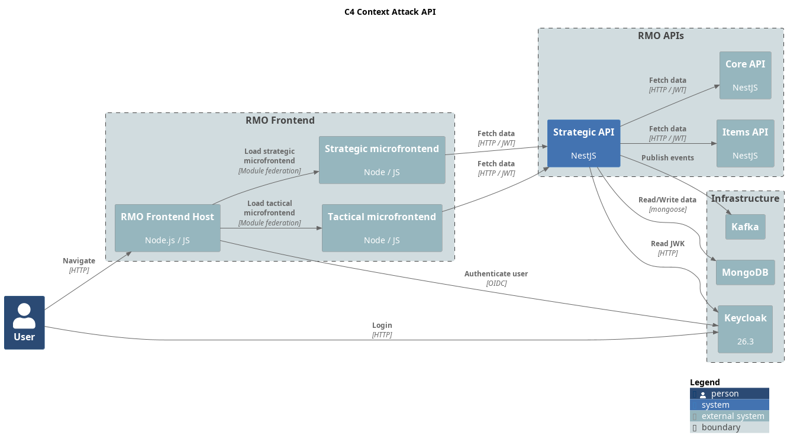

= RMO Items API

REST API for game item management based on Rolemaster Unified.

This project is part of RMU Online: https://github.com/labcabrera/rmu-platform

WARNING: *This application is an independent project developed by fans of Rolemaster Unified. It is not affiliated with, endorsed by, or licensed by Iron Crown Enterprises (ICE), the owners of the Rolemaster intellectual property.*
*All Rolemaster trademarks, game systems, and materials are the property of Iron Crown Enterprises. This software is provided for personal, non-commercial use only. If you enjoy Rolemaster, please support the official publications and content from ICE.*



== Development

This API follows the platform and conventions of https://github.com/labcabrera/rmu-api-core[rmu-api-core] (workspace
spec 020): Node.js 24 (`nvm use`), pnpm 10 through corepack, native ESM with relative `.js` imports, SWC build, Vitest
and the hexagonal + CQRS layout of core's README (*Project layout*, *HTTP contract*).

```bash
cp .env.example .env   # host ports of the rmu-platform infrastructure (make up-infra)
pnpm install
pnpm start:dev         # http://localhost:3006, Swagger UI on /api-docs, OpenAPI JSON on /api-spec
make check             # lint, typecheck, unit and e2e tests
```

[cols="1,3"]
|===
| Command | What it does

| `pnpm build` / `pnpm typecheck` | SWC build to `dist/` / `tsc --noEmit`
| `pnpm lint` / `pnpm format` | typed ESLint + Prettier / Prettier over `src` and `test`
| `pnpm test` | unit tests (`test/unit`)
| `pnpm test:e2e` | one file per resource booting `AppModule` against mongodb-memory-server, with tokens signed against a local JWKS; calls to other APIs and the Kafka producer are replaced (`test/e2e/support`)
| `pnpm test:cov` | unit and e2e tests with the coverage thresholds of `vitest.config.ts` (what CI runs)
| `make docker-build` / `make docker-run` | image `labcabrera/rmu-api-items:latest` (`node:24-bookworm-slim`, `node` user, `HEALTHCHECK`); `docker-run` needs `.env.docker`
| `make create-release` | semantic-release from a clean `develop` into `master`
|===

The Joi schema in `src/config/env.schema.ts` fails startup on a missing required variable. Besides `PORT` (`3006`),
`LOG_LEVEL` (`info`) and `RMU_MONGO_ITEMS_URI`, the HTTP layer reads `RMU_CORS_ORIGINS` (empty: no CORS, browsers come through the
gateway), `RMU_THROTTLE_LIMIT` / `RMU_THROTTLE_TTL_MS` (`300` per `60000` ms and client IP, `0` turns it off) and
`RMU_TRUST_PROXY` (`loopback, linklocal, uniquelocal`). The realm check calls core (`RMU_API_CORE_URI`) with a service
token from Keycloak (`RMU_IAM_TOKEN_URI`, `RMU_IAM_CLIENT_ID`, `RMU_IAM_CLIENT_SECRET`) through the common `HttpClient`:
no answer in `RMU_HTTP_TIMEOUT_MS` (`10000`) is a 504 `upstream-timeout`, core down or a non-2xx other than 404 is a 502.

Errors answer `{ statusCode, error, code, message, timestamp, path }`. Responses carry the `version` of the entity and a
`PATCH` may send it back: a stale one is a 409 `version-conflict`. `size` goes up to 100. `GET /v1/items` accepts up to 1000 (`CatalogPagedQueryDto`), because the item selector of rmu-mfe-strategic loads 250.
Permissions (specs 021, 063 and 073): `GET /v1/item-modifiers/options` is public and creating needs `rmu-user` or
`rmu-admin`. An item with a `realmId` is a child of the realm: the caller's level on the realm decides (`read` reads and
lists it; `write` creates in the realm, changes and deletes the item and its modifiers; `manage` on the realm counts as
`write`), its `owner` gives nothing, a `system` item is read only and `rmu-admin` manages everything. Creating in a realm
the user does not read is a 400 `realm-not-readable`, in one they only read a 403 `realm-not-writable`. The levels come
from core (`GET /realms/access?userId=`, service token), kept 30 s per user in memory: a removed share takes up to that
long to count, and a failure of core is a 502 (access is never granted on error). Admins never ask core. Items without
realm (the global catalog) are readable by every authenticated user and changed by their owner or `rmu-admin`; a
`system` one only by `rmu-admin` (403 `system-entity-admin-only`). `GET /v1/items` lists the global catalog and the
realms the caller reads (an admin lists everything), and every item answers `access` (`manage`, `write` or `read`): what
the caller can do with it. A `PATCH` without changes neither writes nor publishes.
The API consumes `internal.rmu-core.realm.deleted.v1` (consumer group `RMU_KAFKA_CONSUMER_GROUP_ID`) and deletes the
items of the realm, publishing an `item.deleted` for each one; repeating the message does nothing.
The modifiers sent with `POST /v1/items`, a `PATCH` or `POST .../modifiers` follow `GET /v1/item-modifiers/options`
(400 otherwise, spec 044). `scripts/check-item-modifiers.mjs` lists, read-only, the stored items that break those rules
(`RMU_MONGO_ITEMS_URI` from the environment, `DRY_RUN=1 node scripts/check-item-modifiers.mjs`): fix them before
deploying, or a `PATCH` that sends their modifiers back answers 400.
Open problems found during the migration are listed in `docs/reports/api-template-rollout-findings.md` of the workspace.
